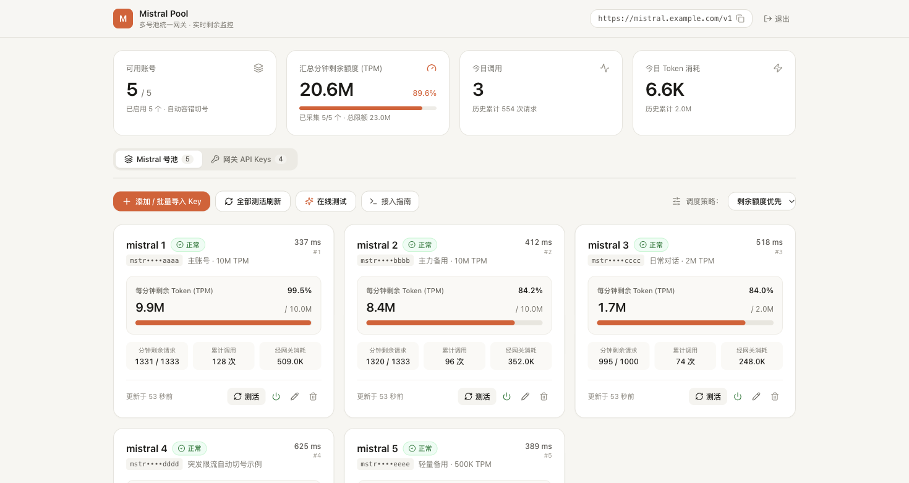
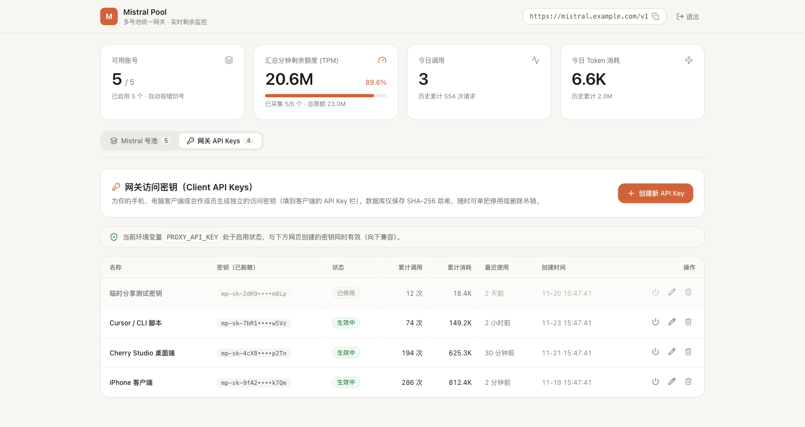

<h1 align="center">Mistral Pool</h1>

<p align="center">
  基于 Cloudflare Workers + D1 的 Mistral 多号池聚合代理网关与实时剩余额度管理看板
</p>

<p align="center">
  <a href="./LICENSE"></a>
  
  
  
</p>

---

如果你手头有多个 Mistral AI API Key（`https://api.mistral.ai/v1`），无需在手机或桌面 AI 客户端中手动切换账号。**Mistral Pool** 将多个 Mistral 账号聚合成单一的 OpenAI 兼容接口，实时追踪每个账号的官方剩余 Token 额度，并在遇到限流或异常时自动无缝切换账号。

## 核心特性

- **单一聚合入口**：提供标准 OpenAI 兼容接口（`/v1/chat/completions`、`/v1/models`、`/v1/embeddings`），支持 SSE 流式输出与完整 CORS。
- **官方剩余额度实时可见**：每次代理对话零额外损耗拦截 Mistral 响应头（`x-ratelimit-remaining-tokens-month`、`x-ratelimit-limit-tokens-month` 及分钟级限额），同时支持单键与全量低消耗测活（`max_tokens: 1`）即时刷新延迟与余额。
- **网关访问密钥管理（Client API Keys）**：直接在网页看板中创建、复制、重命名、停用与删除多把独立的客户端访问密钥，按设备统计调用次数与 Token 消耗；数据库仅存储 SHA-256 哈希，不存明文。
- **三种智能调度策略**：支持「剩余额度优先（默认）」、「均匀轮询」、「顺序用完再切」，看板一键切换。
- **无感故障转移与自动恢复**：遭遇 `429` 限流、`401/403` 密钥失效或 `5xx` 上游异常时，自动标记冷却并在同一次请求中无缝切换下一个可用账号；冷却到期与跨 UTC 自然月后自动解封。
- **零服务器费用部署**：前后端一体化打包部署至 Cloudflare Workers + D1 免费套餐，无长回复流式超时限制。

## 界面预览

### 号池与实时剩余额度总览



### 网关访问密钥管理（Client API Keys）



## 架构概览

```text
┌───────────────────────────┐          ┌────────────────────────────┐
│  AI Client (App / CLI)    │          │  Web Dashboard (Browser)   │
│  Base URL: /v1            │          │  Auth: HttpOnly Cookie     │
│  Auth: Bearer Client Key  │          │  Mobile & Desktop UI       │
└─────────────┬─────────────┘          └─────────────┬──────────────┘
              │ /v1/*                                │ /, /admin/api/*
              ▼                                      ▼
┌───────────────────────────────────────────────────────────────────┐
│              Cloudflare Worker (Hono + Static Assets)             │
│                                                                   │
│  ┌─────────────────────┐  ┌───────────────────┐  ┌─────────────┐  │
│  │  Proxy & Failover   │  │  Admin & Key API  │  │  React UI   │  │
│  │  - Dual Key Auth    │  │  - Pool CRUD      │  │  Static     │  │
│  │  - 3 Strategies     │  │  - Client Keys    │  │  Assets     │  │
│  │  - SSE Usage Tap    │  │  - Probe & Test   │  │             │  │
│  └──────────┬──────────┘  └─────────┬─────────┘  └─────────────┘  │
│             └───────────┬───────────┘                             │
│                         │ Atomic SQL + waitUntil                  │
│                         ▼                                         │
│              ┌─────────────────────┐                              │
│              │ Cloudflare D1 SQLite│                              │
│              │ - api_keys          │                              │
│              │ - client_keys       │                              │
│              │ - request_logs      │                              │
│              │ - settings          │                              │
│              └─────────────────────┘                              │
└───────────────────────────────────────────────────────────────────┘
                          │ HTTPS
                          ▼
             https://api.mistral.ai/v1/*
```

## 快速开始（5 分钟免费部署到 Cloudflare）

### 前置条件

- Node.js 20+
- 一个免费的 Cloudflare 账号

### 1. 克隆并安装依赖

```bash
git clone https://github.com/245678000000/mistral-pool.git
cd mistral-pool
npm install
```

### 2. 登录 Cloudflare 并创建 D1 数据库

```bash
npx wrangler login
npx wrangler d1 create mistral-pool-db
```

复制模板配置文件并填入上一步输出的 `database_id`：

```bash
cp wrangler.example.toml wrangler.toml
# 编辑 wrangler.toml，将 YOUR_D1_DATABASE_ID 替换为真实的 database_id
# 如需绑定自定义域名，取消 wrangler.toml 中 [[routes]] 段的注释并修改域名
```

### 3. 执行数据库建表迁移

```bash
npm run db:migrate:remote
```

### 4. 部署并设置管理员密码

```bash
npm run deploy
npx wrangler secret put ADMIN_PASSWORD
```

可选加密变量（按需设置）：
- `SESSION_SECRET`：32 字节以上随机字符串，用于签发管理看板会话 Cookie（未设置时自动安全派生）。
- `PROXY_API_KEY`：环境变量兜底客户端密钥，支持英文逗号分隔多个；**不设置也可正常使用**，推荐直接在看板「网关 API Keys」页签中可视化创建和管理。

### 5. 初始化使用

1. 打开部署完成后输出的 Worker 网址（或你的自定义域名），使用 `ADMIN_PASSWORD` 登录看板。
2. 在 **「Mistral 号池」** 页点击 **添加 / 批量导入 Key**，每行粘贴一个 Mistral API Key（可选 `名称, Key` 格式），勾选导入后立即测活即可看到每个账号的官方月度剩余 Token 与延迟。
3. 切换到 **「网关 API Keys」** 页，点击 **创建新 API Key**，复制一次性生成的 `mp-sk-...` 密钥。
4. 在你的 AI 客户端（OpenAI 兼容协议）中填写：
   - **Base URL**：`https://<你的域名>/v1`
   - **API Key**：上一步创建的 `mp-sk-...` 密钥

## 本地开发与测试

```bash
# 准备本地环境变量
cp .dev.vars.example .dev.vars

# 初始化本地模拟 D1 数据库
npm run db:migrate:local

# 运行全部单元测试
npm test

# 构建并启动本地 Worker 服务（包含前端看板与本地 D1）
npm run dev
```

## 调度策略说明

| 策略 | 标识 | 行为说明 |
| --- | --- | --- |
| 剩余额度优先（默认） | `remaining_first` | 优先触发未探测账号采集真实额度，随后始终选择本月剩余 Token 最多的健康账号 |
| 均匀轮询 | `round_robin` | 按最久未使用时间顺序轮流分配，均衡分摊分钟级限流压力 |
| 顺序用完再切 | `sequential` | 按账号优先级（数字越小越优先）依次消耗，限流或耗尽时自动切下一个 |

## 安全说明

- 上游 Mistral Key 仅在 Worker 服务端转发时读取，管理接口与前端界面一律脱敏返回（如 `abcd••••wxyz`）。
- 看板创建的网关访问密钥（Client API Keys）在数据库中仅存储 SHA-256 哈希，仅创建瞬间展示一次明文，支持单把停用与立即吊销。
- 关于额度口径：Mistral 官方未向普通 API Key 开放现金充值余额查询接口，看板展示的剩余额度取自官方响应头返回的真实月度/分钟 Token 剩余量，并同步统计经由本网关产生的累计 Token 消耗。

## 开源协议

本项目基于 [MIT License](./LICENSE) 开源。
